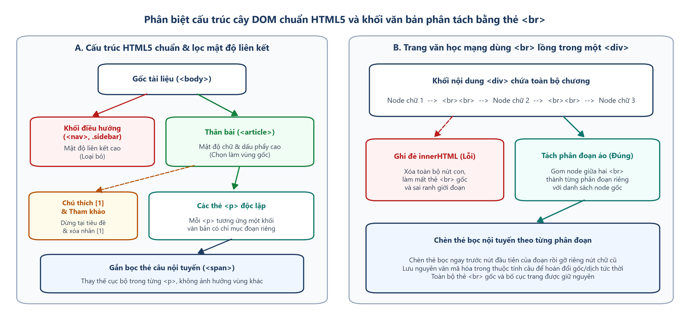
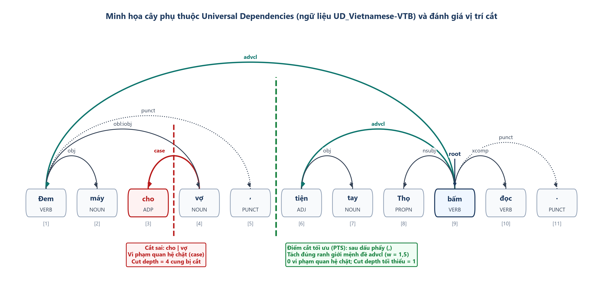

# 3. KIẾN THỨC NỀN TẢNG

Chương này hệ thống hóa các cơ sở lý thuyết và công nghệ nền tảng được sử dụng trực tiếp trong thiết kế mô-đun trích xuất nội dung web, thuật toán phân đoạn văn bản đa ngôn ngữ, quy hoạch động tối ưu hóa ngữ điệu, bộ tiêu chuẩn đánh giá cú pháp phụ thuộc và các mô hình dịch thuật – tổng hợp tiếng nói.

## 3.1. Mô hình tài liệu DOM và kỹ thuật trích xuất nội dung web

Khi trình duyệt tải một trang web, mã nguồn HTML được phân tích thành mô hình đối tượng tài liệu (Document Object Model – DOM), tổ chức toàn bộ trang thành một cấu trúc cây gồm nút phần tử (*element node*) và nút văn bản (*text node*). Trong một trang web điển hình, phần thân bài viết chỉ chiếm một phần của cây DOM và thường nằm xen kẽ với thanh điều hướng, cột bên, hộp thông tin, khung bình luận hoặc các ký hiệu chú thích tham chiếu. Để thu thập dữ liệu sạch phục vụ xử lý ngôn ngữ và đọc thành tiếng, bộ trích xuất cần nhận diện khối nội dung chính dựa trên thẻ ngữ nghĩa HTML5, mẫu định danh lớp phổ biến và chỉ số mật độ liên kết (*link density*), được xác định bằng tỷ lệ số ký tự nằm bên trong thẻ siêu liên kết trên tổng số ký tự của khối; những khối có mật độ liên kết cao thường là trình đơn điều hướng thay vì đoạn văn tự nhiên.

Một khó khăn kỹ thuật phổ biến là sự khác biệt trong cách trình bày đoạn văn giữa các trang web. Bên cạnh chuẩn HTML5 tách từng đoạn bằng thẻ `
` độc lập, nhiều trang văn học mạng gộp toàn bộ nội dung chương vào một phần tử khối lớn và chỉ chèn cặp thẻ ngắt dòng ` ` giữa các đoạn. Nếu chèn thẻ câu bằng cách ghi đè trực tiếp thuộc tính `innerHTML` của phần tử cha, toàn bộ cấu trúc ` ` nguyên thủy và các nút con không thuộc chuỗi thay thế dễ bị xóa hoặc dựng sai lệch. Do đó, việc gắn thẻ cấp câu trực tiếp trên cây DOM cần gom các nút chữ theo ranh giới giữa hai thẻ ` ` liên tiếp thành từng phân đoạn độc lập rồi thay thế cục bộ, qua đó bảo toàn nguyên vẹn bố cục hiển thị của trang gốc như minh họa ở Hình 3.1.

*Hình 3.1. So sánh trích xuất cây DOM chuẩn `
` với khối văn bản phân tách bằng ` ` và bộ lọc mật độ liên kết.*

## 3.2. Phân tách đơn vị văn bản Unicode và ánh xạ chỉ số đa môi trường

Trong bài toán xử lý ngôn ngữ đa hệ chữ viết, việc phân tách từ và nhận diện ranh giới câu đòi hỏi phân loại ký tự theo danh mục Unicode (*Unicode General Categories*) thay vì giới hạn trong bảng mã ASCII. Mỗi ký tự được gán vào nhóm chức năng cụ thể như chữ cái viết hoa (`Lu`), chữ cái viết thường (`Ll`), chữ số (`Nd`), dấu kết hợp (`Mn`, `Mc`), khoảng trắng đa dạng (`U+00A0`, `U+2000`–`U+200A`, `U+3000`...) hoặc khối chữ tượng hình CJK (`U+4E00`–`U+9FFF`, `U+3400`–`U+4DBF`) và chữ Kana tiếng Nhật (`U+3040`–`U+30FF`). Cách phân loại này giúp cùng một bộ phân tách xử lý đồng nhất chữ tiếng Việt có dấu thanh ghép, chữ Latinh tiếng Anh lẫn chữ Hán không sử dụng khoảng trắng.

Khi thuật toán phân đoạn chạy đồng thời trên cả JavaScript/TypeScript phía trình duyệt và Python phía máy chủ, sự khác biệt trong cách lưu trữ chuỗi nội bộ tạo ra bài toán ánh xạ chỉ số. Python từ phiên bản 3 đánh chỉ số chuỗi theo từng điểm mã Unicode (*Unicode code point*), nghĩa là mọi ký tự kể cả biểu tượng ngoài mặt phẳng cơ bản BMP (`> U+FFFF`) đều có độ dài bằng 1. Ngược lại, động cơ JavaScript mã hóa chuỗi nội bộ theo UTF-16, khiến mỗi ký tự ngoài mặt phẳng BMP chiếm 2 đơn vị độ dài (*surrogate pair*). Nếu không quy đổi vị trí khớp biểu thức chính quy từ hệ tọa độ UTF-16 sang chỉ số điểm mã Unicode, biên phân đoạn trên chuỗi chứa biểu tượng cảm xúc hoặc ký tự toán học đặc biệt sẽ bị lệch giữa trình duyệt và máy chủ. Bảng 3.1 đối chiếu độ dài chỉ số và trọng số hiệu dụng của một số ký tự đại diện.

| Ký tự mẫu | Loại chữ viết | Mã Unicode | Độ dài Python (Code point) | Độ dài JS (UTF-16) | Trọng số hiệu dụng $w(x)$ |
| :---: | :--- | :---: | :---: | :---: | :---: |
| `A` | Chữ Latinh cơ bản | `U+0041` | `1` | `1` | `1,0` |
| `ệ` | Chữ tiếng Việt ghép dấu | `U+1EC7` | `1` | `1` | `1,0` |
| `字` | Chữ Hán (CJK) | `U+5B57` | `1` | `1` | `3,0` |
| `📘` | Biểu tượng ngoài BMP | `U+1F4D8` | `1` | `2` | `1,0` |

*Bảng 3.1. Đối chiếu biểu diễn chỉ số chuỗi đa môi trường và trọng số độ dài hiệu dụng.*

## 3.3. Ngữ điệu lời nói, độ dài hiệu dụng và Ngữ pháp phụ thuộc Universal Dependencies

Trong tổng hợp tiếng nói, cảm nhận về độ trôi chảy của người nghe phụ thuộc mật thiết vào cách chia câu dài thành các cụm ngữ điệu (*prosodic phrases*). Về mặt ngôn ngữ học, điểm ngắt hơi tự nhiên tuân theo thứ bậc liên kết cú pháp giảm dần: ranh giới kết thúc câu độc lập đứng ở mức tách rời cao nhất, tiếp theo là dấu câu ngắt mệnh đề mạnh (dấu chấm phẩy, hai chấm), dấu gạch ngang tách ý phụ, dấu phẩy ngăn vế, ranh giới trước liên từ nối mệnh đề và ranh giới trước từ chức năng mở đầu cụm danh từ hoặc cụm giới từ.

Theo hướng bám ngữ pháp, các từ chức năng không đối xứng khi xem xét vị trí ngắt. Nhóm từ bám phải (*proclitics*) như giới từ, từ hạn định, hệ từ và trợ động từ trong tiếng Việt và tiếng Anh (*của, cho, trong, với, các, những, một, đã, đang, of, in, at, the, will*) cùng giới từ và đồng động từ tiếng Trung (*在, 把, 被, 对, 从, 向, 给, 于*) gắn chặt với ngữ đoạn đứng sau, nên ngắt hơi ngay trước nhóm từ này tự nhiên hơn việc tách ngay phía sau chúng. Trái lại, nhóm tiểu từ hậu trí bám trái (*enclitics*) như từ chỉ định và tình thái tiếng Việt (*này, đó, kia, ấy, nhé, ạ*) hay trợ từ kết cấu và thể tiếng Trung (*的, 了, 着, 过, 地, 吗, 呢*) liên kết trực tiếp với thực từ liền trước, nên việc tách rời tiểu từ sang đầu đoạn tiếp theo tạo cảm giác ngắt quãng gượng gạo.

Dưới góc độ đa ngôn ngữ với cùng một giới hạn đầu vào $L_{\max}$, độ dài tính theo số ký tự thô không phản ánh đúng thời lượng đọc. Một chữ Hán mang giá trị một âm tiết trọn vẹn, tương đương khoảng ba đến bốn ký tự gồm cả khoảng trắng trong tiếng Việt hoặc tiếng Anh. Do đó, khái niệm độ dài hiệu dụng của phân đoạn $c$ được định nghĩa qua tổng trọng số ký tự $L_{\text{eff}}(c) = \sum_{x \in c} w(x)$, với $w(x) = 3{,}0$ cho chữ khối CJK/Kana và $w(x) = 1{,}0$ cho các ký tự còn lại, bảo đảm thời lượng phát âm tương đương giữa ba ngôn ngữ.

Để đánh giá chất lượng các vị trí cắt một cách khách quan không phụ thuộc cảm tính, nghiên cứu sử dụng khung **Universal Dependencies (UD)**. Trong UD, mỗi câu gồm chuỗi token kèm nhãn từ loại (`UPOS`) và một cây phụ thuộc có gốc, trong đó mỗi từ $u$ nối tới từ cha $h = \text{HEAD}(u)$ bằng nhãn quan hệ cú pháp (`DEPREL`). Trên cây phụ thuộc vàng, chất lượng một điểm cắt nội bộ được kiểm chứng theo bốn tiêu chí định lượng: có rơi vào giữa một token từ ghép hay không, có vi phạm nhóm quan hệ phụ thuộc chặt không thể tách rời (`case`, `det`, `mark`, `aux`, `cop`, `clf`, `compound`, `flat`, `fixed`, `nummod`, `goeswith`) hay không, có trùng với dấu câu hoặc ranh giới mệnh đề (`conj`, `parataxis`, `advcl`, `ccomp`, `acl`, `cc`, `appos`) hay không, và số cung phụ thuộc bị cắt ngang (*cut depth*). Hình 3.2 minh họa cách đánh giá các vị trí cắt trực tiếp trên một câu trích từ kho ngữ liệu `UD_Vietnamese-VTB`.

*Hình 3.2. Minh họa cây phụ thuộc UD (`UD_Vietnamese-VTB`): điểm cắt tại dấu phẩy tách đúng ranh giới mệnh đề (`advcl`, cut depth = 1), ngược với điểm cắt giữa cặp `case` (`cho | vợ`, cut depth = 4).*

## 3.4. Quy hoạch động tối ưu phân hoạch chuỗi có ràng buộc

Bài toán phân hoạch một câu gồm $M$ token phi khoảng trắng $t_0, t_1, \dots, t_{M-1}$ thành các đoạn nối tiếp không vượt quá $L_{\max}$ được mô hình hóa thành bài toán tìm đường đi ngắn nhất trên đồ thị không chu trình có hướng (DAG). Một phân hoạch hợp lệ ứng với dãy ranh giới $0 = i_0 < i_1 < \dots < i_K = M$ sao cho mọi phân đoạn thứ $k$ thỏa $L_{\text{eff}}(i_{k-1}, i_k) \le L_{\max}$. Đặt $F(j)$ là chi phí tối ưu cho tiền tố gồm $j$ token đầu tiên, quan hệ truy hồi quy hoạch động được phát biểu như sau:

$$F(0) = 0, \qquad F(j) = \min_{\substack{0 \le i < j \\ L_{\text{eff}}(i, j) \le L_{\max}}} \left[ F(i) + C_{\text{seg}}(i, j) + C_{\text{break}}(j) \right]$$

Trong công thức trên, $C_{\text{seg}}(i, j)$ biểu diễn chi phí nội tại của phân đoạn $[i, j)$ gồm phí cố định mỗi lần phát sinh một phân đoạn và thành phần phạt liên quan đến độ dài, còn $C_{\text{break}}(j)$ là chi phí ngữ điệu phải trả khi đặt điểm dừng tại ranh giới giữa $t_{j-1}$ và $t_j$ (với $C_{\text{break}}(M) = 0$). Nhờ độ dài hiệu dụng $L_{\text{eff}}(i, j)$ tăng đơn điệu theo độ dài đoạn, số ứng viên $i < j$ thỏa ràng buộc $L_{\text{eff}}(i, j) \le L_{\max}$ bị chặn bởi kích thước cửa sổ tối đa $k$ trong câu, đưa độ phức tạp tính toán về $O(M \cdot k)$ thay vì $O(M^2)$ và bảo đảm tìm được phân hoạch tối ưu toàn cục.

## 3.5. Dịch thuật ngữ cảnh qua mô hình ngôn ngữ lớn và công nghệ tổng hợp tiếng nói đa tầng

Khác với dịch máy dựa trên cụm từ truyền thống, các mô hình ngôn ngữ lớn (Large Language Models – LLM) vận hành theo cơ chế sinh chuỗi dựa trên cửa sổ ngữ cảnh dài và chỉ dẫn hệ thống (System Prompt). Khi áp dụng vào hệ thống chuyển ngữ phục vụ tổng hợp tiếng nói, việc phân tách System Prompt theo thể loại cho phép định hướng đầu ra phù hợp với thính giác thay vì chỉ đọc lướt bằng mắt: lược bỏ ký hiệu định dạng không phát âm được, giữ chuẩn thuật ngữ chuyên môn kèm danh pháp gốc trong tài liệu khoa học, hoặc ưu tiên tính tự nhiên về đại từ và nhịp điệu kể trong văn bản văn học. Sau khi sinh, đầu ra cần trải qua bước hậu kiểm dựa trên phân loại ký tự Unicode để phát hiện câu còn sót nguyên văn ngoại ngữ hoặc lẫn hệ chữ viết nguồn trước khi chuyển sang bước tổng hợp âm thanh.

Ở tầng sinh âm thanh, việc kết hợp cả dịch vụ đám mây và mô hình học sâu cục bộ giúp cân bằng giữa độ tự nhiên và tính ổn định khi vận hành. Các bộ tổng hợp đám mây (như TikTok/CapCut TTS và Microsoft Edge Neural TTS qua WebSocket) cung cấp kho giọng đọc đa ngôn ngữ phong phú nhưng phụ thuộc kết nối mạng và giới hạn độ dài từng gói văn bản. Ngược lại, mô hình đầu-cuối **VITS** (Kim et al., 2021) sau khi chuyển sang định dạng **ONNX (Open Neural Network Exchange)** cho phép suy luận sóng âm trực tiếp trên CPU máy người dùng qua ONNX Runtime và Piper, loại bỏ sự phụ thuộc vào hạ tầng huấn luyện nặng và bảo đảm khả năng nghe văn bản tiếng Việt cả khi không có Internet.
