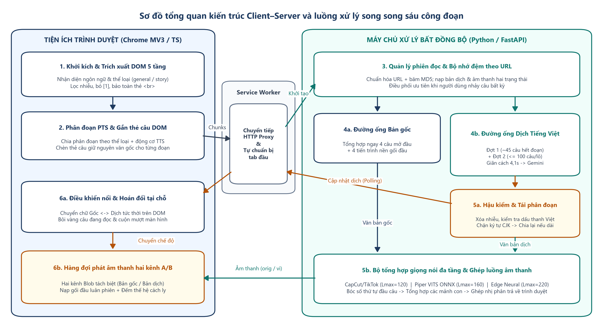
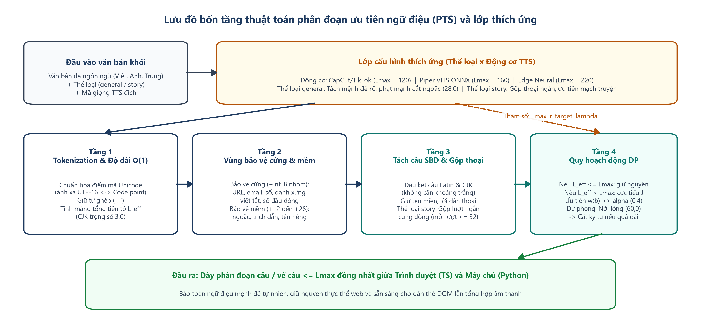

# 4. ĐỀ XUẤT GIẢI PHÁP

Chương này trình bày kiến trúc tổng thể, công nghệ nền tảng và cơ chế vận hành của hệ thống qua từng công đoạn xử lý, trong đó đi sâu thiết kế thuật toán phân đoạn văn bản ưu tiên ngữ điệu (PTS), khung tối ưu quy hoạch động kèm mã giả và ví dụ minh họa trên dữ liệu đa ngôn ngữ.

## 4.1. Tổng quan kiến trúc, công nghệ sử dụng và luồng xử lý hệ thống

Hệ thống được xây dựng theo kiến trúc khách – chủ bất đồng bộ nhằm tách biệt khâu tương tác trực tiếp với cây tài liệu trên trình duyệt khỏi các tác vụ xử lý ngôn ngữ, dịch thuật theo ngữ cảnh, tổng hợp âm thanh và lưu trữ bộ nhớ đệm tập trung. Phía trình duyệt là tiện ích mở rộng Google Chrome chuẩn Manifest V3 phát triển bằng TypeScript 5.4 trên nền tảng WXT 0.21.4 và Vite 6.4, kết hợp React 18 và thư viện `@mozilla/readability` 0.5.0. Phía máy chủ sử dụng Python 3.11 trên nền tảng FastAPI cùng thư viện `asyncio` và `httpx` để điều phối tác vụ gọi Google Gemini (`gemini-3.1-flash-lite` hoặc `gemini-3.5-flash-lite`) và ba bộ tổng hợp tiếng nói gồm CapCut/TikTok TTS, Microsoft Edge Neural TTS (WebSocket) và Piper VITS ONNX chạy ngoại tuyến trên CPU cục bộ.

| Thành phần kiến trúc | Công nghệ / Dịch vụ sử dụng | Vai trò trong hệ thống |
| :--- | :--- | :--- |
| Tiện ích trình duyệt | TypeScript 5.4, WXT 0.21.4, Vite 6.4, Chrome MV3, React 18 | Trích xuất DOM, chạy bộ phân đoạn ngôn ngữ trên trình duyệt, chèn thẻ câu, hiển thị thanh điều khiển nổi và phát âm thanh kép. |
| Khoanh vùng bài viết phụ trợ | Thư viện `@mozilla/readability` 0.5.0 | Hỗ trợ tách phần thân bài chính trên trang báo chí và bài viết tổng quát khi bộ chọn trực tiếp chưa khớp. |
| Máy chủ điều phối | Python 3.11, FastAPI, `asyncio`, `httpx` | Quản lý phiên đọc đa luồng, chia lô dịch thuật, điều phối tổng hợp âm thanh song song và quản lý bộ nhớ đệm theo URL. |
| Mô hình dịch thuật | Google Gemini API (`gemini-3.1/3.5-flash-lite`) | Dịch ngữ cảnh theo hai hồ sơ văn phong (thông tin chung và truyện tự sự) kết hợp điều tiết tần suất yêu cầu. |
| Bộ tổng hợp tiếng nói đám mây | CapCut/TikTok TTS API, Microsoft Edge Neural TTS | Sinh giọng đọc bản gốc đa ngôn ngữ và bản dịch tiếng Việt tự nhiên với ngưỡng độ dài và tốc độ phản hồi thích ứng. |
| Bộ tổng hợp tiếng nói ngoại tuyến | Mô hình Piper VITS ONNX, thư viện Wave và NumPy | Suy luận giọng nữ tiếng Việt ngoại tuyến trên CPU máy cục bộ và đóng gói luồng sóng âm chuẩn WAV PCM 16-bit đơn kênh. |

*Bảng 4.1. Danh mục công nghệ thực tế được sử dụng trong hệ thống.*

Về phương diện thiết kế phần mềm, hệ thống phối hợp các mô-đun chức năng thuần túy cho khâu lọc chuỗi và DOM với mô hình hướng đối tượng cho các thành phần quản lý trạng thái phức tạp như bộ phân tích ngữ đoạn, phiên đọc đa luồng, bộ dịch thuật, bộ tổng hợp đa động cơ, bộ nhớ đệm theo URL và hàng đợi phát âm thanh hai kênh. Bảng 4.2 tóm tắt trách nhiệm của các khối xử lý logic chính trong kiến trúc.

| Khối xử lý logic | Môi trường | Trách nhiệm cốt lõi trong luồng vận hành |
| :--- | :--- | :--- |
| Khối trích xuất và làm sạch DOM | Trình duyệt | Khoanh vùng bài viết năm tầng, lọc nhiễu giao diện và chú thích, nhận diện ngôn ngữ trang và phân loại thể loại văn bản. |
| Bộ phân đoạn ưu tiên ngữ điệu (PTS) | Trình duyệt & Máy chủ | Tách token Unicode, khoanh vùng bảo vệ thực thể, phát hiện ranh giới câu và quy hoạch động tối ưu điểm ngắt ngữ điệu. |
| Khối đồng bộ thẻ câu trên DOM | Trình duyệt | Bọc từng vế câu vào thẻ nội tuyến mà vẫn giữ nguyên cấu trúc `<br>`, lưu nguyên văn để hoán đổi chữ gốc/dịch và tô sáng câu đang đọc. |
| Trình chuyển tiếp nền (Service Worker) | Trình duyệt | Cấp quyền tự chuẩn bị trước cho tab mở đầu tiên và chuyển tiếp mọi yêu cầu HTTP về máy chủ cục bộ nhằm tránh lỗi bảo mật chéo nguồn. |
| Trình quản lý phiên đọc đa luồng | Máy chủ Python | Chạy song song đường ống bản gốc và đường ống tiếng Việt, xử lý hàng đợi ưu tiên khi người dùng nhảy câu và đồng bộ trạng thái. |
| Bộ dịch ngữ cảnh và hậu kiểm | Máy chủ Python | Gửi lô câu theo ngữ cảnh đoạn với giãn cách 4,1 giây, bóc tách theo chỉ số dòng và lọc bỏ câu dịch lỗi hoặc còn lẫn ngoại ngữ. |
| Bộ tổng hợp đa tầng và bộ nhớ đệm URL | Máy chủ Python | Bóc số đầu dòng, chia mảnh bổ sung cho câu dịch vượt ngưỡng, gọi ba động cơ TTS, lưu đệm theo mã băm URL chuẩn hóa và thu dọn khi tắt. |
| Hàng đợi phát âm thanh hai kênh | Trình duyệt | Lưu tách biệt bộ đệm Blob cho bản gốc và bản dịch, nạp gối đầu luân phiên hai khe phát và gắn chỉ số thế hệ khi chuyển chế độ. |

*Bảng 4.2. Phân chia trách nhiệm giữa các khối xử lý chính trong hệ thống.*

Nhìn tổng quan trên Hình 4.1, toàn bộ luồng vận hành từ lúc người dùng mở trang web đến khi âm thanh phát ra loa được chia thành sáu công đoạn khép kín, vận hành song song giữa máy khách và máy chủ để tối ưu độ trễ phản hồi.



*Hình 4.1. Sơ đồ tổng quan kiến trúc Client–Server và luồng xử lý song song sáu công đoạn từ trích xuất trang web đến phát âm thanh kép.*

Ở hai công đoạn đầu phía trình duyệt, tiện ích ưu tiên tự chuẩn bị trước cho tab đầu tiên mới mở (trong khi các tab phụ giữ trạng thái chờ để tiết kiệm tài nguyên), trích xuất nội dung sạch kèm ngôn ngữ và thể loại, rồi đưa qua bộ phân đoạn PTS để chia thành từng vế câu và gắn trực tiếp thẻ định danh lên cây DOM. Tiếp theo, ở công đoạn thứ ba, danh sách vế câu được gửi qua Service Worker tới máy chủ FastAPI để đối chiếu bộ nhớ đệm theo URL chuẩn hóa, cho phép nạp lại ngay bản dịch và tệp âm thanh nếu trang đã được xử lý trong cùng phiên chạy.

Từ công đoạn thứ tư đến thứ sáu, máy chủ chạy đồng thời hai đường ống độc lập: đường ống bản gốc tổng hợp ngay 4 câu mở đầu rồi giao phần còn lại cho 4 tiến trình chạy nền (hỗ trợ nhảy ưu tiên tới bất kỳ câu nào người dùng bấm chọn), trong khi đường ống tiếng Việt dịch đợt đầu khoảng 45 vế câu (mở rộng tới hết đoạn văn giữ trọn ngữ cảnh) rồi dịch ngầm từng lô tối đa 100 câu. Bản dịch sau khi qua bộ lọc hậu kiểm và tái phân đoạn nếu vượt giới hạn động cơ sẽ đi qua bộ tổng hợp đa tầng để trả dần về hàng đợi phát đệm kép A/B phía trình duyệt, hỗ trợ nghe liên tục hoặc chuyển đổi tức thời giữa bản gốc và bản dịch.

## 4.2. Công đoạn trích xuất nội dung web và bảo toàn cấu trúc DOM

Để trích xuất chính xác phần nội dung chính trên nhiều loại bố cục trang web, bộ thu thập thực hiện chiến lược khoanh vùng phân cấp năm tầng. Nếu người dùng đang bôi đen một đoạn dài hơn 20 ký tự, hệ thống đọc riêng vùng được chọn thay vì cả trang. Khi không có vùng chọn, thuật toán tuần tự đối chiếu bộ chọn chuyên biệt cho các trang bách khoa và blog lớn (Wikipedia, Fandom, Medium), bộ chọn khối chứa chuẩn của trang đọc truyện, thuật toán Readability của Mozilla, bộ tự chấm điểm mật độ văn bản (cộng điểm theo độ dài chữ và số dấu phẩy, trừ điểm mạnh theo tỷ lệ mật độ liên kết), và cuối cùng mới dùng phần thân trang nếu các tầng trên không đủ ngưỡng văn bản tối thiểu.

Sau khi chọn được khối gốc, bộ duyệt cây DOM đi theo thứ tự đọc và áp dụng ba lớp lọc nhiễu. Lớp thứ nhất loại bỏ các thẻ phi nội dung (kịch bản, định dạng, đồ họa, công thức toán học, nút bấm, khung nhúng), các vùng giao diện phụ (thanh điều hướng, cột bên, chân trang, bảng, khối ẩn qua CSS) cùng các khối nhiễu Wikipedia hoặc diễn đàn như hộp thông tin, mục lục, khối tham chiếu và khu vực bình luận. Lớp thứ hai tự động dừng duyệt khi gặp tiêu đề cấp lớn đánh dấu phần tài liệu tham khảo, xem thêm hoặc bình luận sau thân bài nhằm tránh thu thập hàng trăm dòng trích dẫn cuối trang. Lớp thứ ba loại bỏ các thẻ chú thích chỉ số trên và xóa ký hiệu tham chiếu dạng `[1]`, `[citation needed]`, `[sửa]` trong chuỗi thô.

Nhằm bảo toàn bố cục trên các trang văn học mạng không dùng thẻ `<p>` độc lập mà gộp cả chương trong một `<div>` ngăn cách bằng nhiều thẻ `<br>`, bộ trích xuất gom các nút văn bản giữa hai thẻ `<br>` liên tiếp thành từng phân đoạn riêng kèm tham chiếu tới các nút gốc. Khi gắn thẻ câu lên giao diện, hệ thống tạo một thẻ bọc nội tuyến chèn ngay vào trước nút đầu tiên của phân đoạn rồi gỡ riêng các nút chữ cũ thuộc đoạn đó, nhờ vậy toàn bộ thẻ `<br>` nguyên thủy được giữ nguyên không bị ghi đè. Đồng thời, nguyên văn từng vế câu được mã hóa và lưu trực tiếp trên thuộc tính thẻ câu để hoán đổi hiển thị gốc/dịch ngay tại chỗ.

Ngay trên phần văn bản mẫu vừa trích xuất, hệ thống thực hiện đồng thời hai bước phân loại tự động. Bước nhận diện ngôn ngữ kiểm tra tần suất nhóm ký tự đặc trưng (dấu thanh tiếng Việt, khối chữ Hán, Kana, Hangul, Kirin, Ả Rập, Thái, Ấn Độ và phân biệt nhóm ngôn ngữ Latinh theo tập từ dừng). Bước nhận diện thể loại phân trang thành văn bản tự sự (`story`) hoặc thông tin chung (`general`) bằng cách kết hợp tên miền, từ khóa tiêu đề (chương, hồi, truyện, chapter, novel) và đặc trưng bề mặt như mật độ dấu ngoặc kép hội thoại và dấu cảm thán.

## 4.3. Thuật toán phân đoạn văn bản ưu tiên ngữ điệu (PTS) và thích ứng đa thể loại

Thuật toán phân đoạn văn bản ưu tiên ngữ điệu (**PTS – Prosody-aware Text Segmenter**) đóng vai trò thành phần xử lý ngôn ngữ cốt lõi, được cài đặt đồng bộ về mặt logic giữa trình duyệt (TypeScript) và máy chủ (Python). Hình 4.2 khái quát dòng xử lý bốn tầng kết hợp lớp tham số thích ứng theo thể loại và động cơ TTS.



*Hình 4.2. Lưu đồ xử lý bốn tầng của thuật toán PTS kết hợp cơ chế thích ứng đa thể loại và đa động cơ TTS.*

### 4.3.1. Tầng 1: Tokenization theo chuẩn Unicode và quy đổi độ dài hiệu dụng

Ở tầng đầu tiên, văn bản đầu vào được tách thành mảng điểm mã Unicode chuẩn để phân loại tuyến tính thành bốn loại đơn vị gồm khoảng trắng, chữ tượng hình hoặc âm tiết Đông Á (CJK và Kana), từ hoặc chuỗi chữ số Latinh, và dấu câu đơn lẻ. Riêng đối với đơn vị Latinh, các từ ghép nối qua dấu gạch nối hoặc dấu nháy đơn (như *COVID-19*, *e-mail*, *don't*) được giữ liền một đơn vị nếu hai phía ký tự nối đều là chữ cái hoặc chữ số. Để tránh lệch chỉ số giữa biểu diễn chuỗi UTF-16 trong JavaScript (trong đó ký tự ngoài mặt phẳng cơ bản chiếm hai đơn vị) và biểu diễn điểm mã trong Python, phiên bản phía trình duyệt xây dựng bảng ánh xạ từ tọa độ UTF-16 sang tọa độ điểm mã Unicode chuẩn, bảo đảm kết quả cắt khớp nhau trên mọi văn bản chứa biểu tượng hay ký tự đặc biệt.

Để áp đặt cùng một ngưỡng đầu vào $L_{\max}$ cho các ngôn ngữ khác loại hình, thuật toán xây dựng mảng tổng tiền tố độ dài hiệu dụng trong thời gian $O(n)$, tính trọng số $3{,}0$ cho mỗi ký tự khối CJK/Kana và $1{,}0$ cho các ký tự còn lại. Nhờ mảng tổng tiền tố, độ dài hiệu dụng $L_{\text{eff}}(s, e)$ của mọi phân đoạn bất kỳ được truy xuất trong $O(1)$. Với quy ước này, giới hạn $L_{\max} = 120$ tương ứng tối đa 120 ký tự ở tiếng Việt/tiếng Anh và tối đa 40 chữ Hán ở tiếng Trung, giữ cân bằng thời lượng phát ra loa giữa ba ngôn ngữ.

### 4.3.2. Tầng 2: Nhận diện vùng bảo vệ cứng và vùng bảo vệ mềm

Trước khi tách câu và phân đoạn, thuật toán quét qua chuỗi ký tự để khoanh hai lớp vùng bảo vệ. Lớp bảo vệ cứng gán chi phí cắt bằng $+\infty$ lên các khoảng nội bộ của tám nhóm cấu trúc không thể tách rời: địa chỉ liên kết web (tự động gọt dấu đóng câu thừa ở cuối như chấm, phẩy, ngoặc), thư điện tử, chuỗi số có dấu phân cách nội bộ (số thập phân, số tiền, ngày tháng, giờ, IP), cụm viết tắt nhiều dấu chấm (`U.S.`, `v.v.`, `a.m.`), nhóm từ viết tắt chức danh và đơn vị hành chính phổ biến (`TP.`, `PGS.`, `TS.`, `ThS.`, `GS.`, `Dr.`, `Prof.`, `Mr.`, `Mrs.`...), từ viết tắt thông dụng và tên tháng tiếng Anh (`etc.`, `Inc.`, `vv.`), từ viết tắt đi liền chữ số phía sau (`Fig. 3`, `No. 5`, `Vol. 2`), chữ cái viết tắt tên riêng một ký tự (`J. K.`), và chỉ số đánh dấu đầu dòng gồm một đến ba chữ số theo sau bởi dấu chấm. Riêng với bốn nhóm gắn trực tiếp vào thành phần theo sau (chức danh, viết tắt kèm số, chữ cái đầu tên riêng và số đầu dòng), thuật toán khóa thêm khoảng trắng liền sau dấu chấm để tránh chia tách `PGS. | TS.` hay `1. | Mở đầu`.

Song song với đó, lớp bảo vệ mềm gán mức phạt chi phí cao cho các ranh giới nằm trong ba loại ngữ đoạn có độ dài hiệu dụng $\le L_{\max}$: cụm giải thích hoặc danh pháp trong cặp dấu ngoặc đơn/vuông, cụm trích dẫn trong dấu ngoặc kép (có kiểm tra hướng mở của dấu nháy ASCII để không nhầm với ký hiệu inch như `27"`), và chuỗi hai từ viết hoa liên tiếp biểu thị tên riêng (`Nguyễn Văn An`, `Từ Tiểu Thụ`, `New York`). Dùng vùng mềm giúp giữ nguyên danh pháp hoặc tên riêng trong đa số câu văn nhưng vẫn cho phép tìm điểm chia hợp lệ nếu cả cụm vượt ngưỡng $L_{\max}$.

### 4.3.3. Tầng 3: Phát hiện ranh giới câu và cơ chế gộp lượt thoại ngắn

Tầng tách câu xem vị trí xuống dòng và các cụm dấu kết câu Latinh (`.`, `!`, `?`, `…`) lẫn dấu kết câu toàn chiều rộng Đông Á (`。`, `！`, `？`) kèm chuỗi dấu đóng ngoặc theo sau là ứng viên kết thúc câu. Một ứng viên bị loại bỏ khi rơi vào các trường hợp ngoại lệ: dấu chấm nằm bên trong vùng bảo vệ cứng (trừ viết tắt thông dụng và cụm viết tắt đa chấm khi ký tự tiếp theo viết hoa); trong ngữ cảnh phi CJK ngay sau dấu chấm không có khoảng trắng và ký tự tiếp theo không phải dấu mở ngoặc hay chữ CJK (giữ nguyên tên kỹ thuật như `Node.js`); ký tự kế tiếp sau dấu kết câu hoặc dấu đóng ngoặc là chữ thường (giữ liền thoại có lời dẫn như *"Đi thôi!" hắn nói khẽ.*); hoặc ký tự kế tiếp là dấu phẩy hay chấm phẩy. Với văn bản CJK, dấu kết câu toàn chiều rộng cho phép ngắt câu ngay cả khi không có khoảng trắng ngăn cách. Các phân đoạn chỉ gồm dấu câu ở cuối đoạn được gộp ngược vào câu liền trước.

Riêng ở thể loại truyện chữ, tầng tách câu thực hiện thêm một lượt hậu xử lý gộp lượt thoại ngắn. Hai câu ngắn liên tiếp nằm trên cùng một dòng (không có ký tự xuống dòng xen giữa) được gộp làm một đơn vị phát nếu mỗi câu thành phần có độ dài hiệu dụng $\le 32{,}0$ và tổng độ dài sau gộp không vượt quá $\min(72{,}0;\, 0{,}68\,L_{\max})$. Quy tắc này giúp ghép các nhịp cảm thán ngắn liên tiếp thành một cụm tự nhiên trong khi không dồn nhầm lượt thoại vào câu tường thuật dài kế bên.

### 4.3.4. Tầng 4: Quy hoạch động Ưu tiên Ngữ điệu và Thuật toán tìm đường tối ưu

Với mọi câu hoàn chỉnh có độ dài hiệu dụng $L_{\text{eff}} > L_{\max}$, tầng tối ưu hóa tìm phân hoạch gồm $K$ phân đoạn $c_1, \dots, c_K$ (đều thỏa $L_k \le L_{\max}$) sao cho tổng chi phí $J$ đạt giá trị cực tiểu:

$$J(c_1 \dots c_K) = \sum_{k=1}^{K} \left[ \lambda + \alpha \left(\frac{L_k - T}{T}\right)^2 + \beta \cdot \mathbb{I}(L_k < \min(L_{\min}, 0{,}3\,L_{\max})) \right] + \sum_{b} w(b)$$

Trong công thức trên, $T = r_{\text{target}} \cdot L_{\max}$ là độ dài tham chiếu, $\lambda$ là chi phí cố định mỗi lần phát sinh phân đoạn nhằm cực tiểu hóa số vết chia, $\beta = 3{,}0$ phạt mẩu vụn quá ngắn và $w(b)$ là chi phí ngữ điệu tại ranh giới $b$ cộng dồn với phạt vùng bảo vệ mềm. Khác với bài toán cân bằng độ dài dòng của dàn trang, thuật toán giữ hệ số cân bằng $\alpha$ ở mức nhỏ ($\alpha = 0{,}4$) để chủ yếu phân định khi hai ứng viên có cùng cấp độ ngữ điệu, đồng thời phân cấp rõ ràng chi phí ranh giới $w(b)$ theo Bảng 4.3. Quy trình giải chính xác quy hoạch động trong $O(M \cdot k)$ được mô tả cô đọng tại Thuật toán 4.1.

```text
Thuật toán 4.1: Phân hoạch câu ưu tiên ngữ điệu (Prosody-First DP)
Đầu vào : Dãy M token phi khoảng trắng t[0..M-1], giới hạn L_max, cấu hình (T, lambda, alpha, beta)
          Mảng tổng tiền tố P, chi phí biên breakCost[1..M], vùng cấm hardGap[1..M], vùng mềm softGap[1..M]
Đầu ra  : Danh sách các phân đoạn tối ưu có L_eff <= L_max

1.  Khởi tạo F[0] <- 0; F[1..M] <- +INF; back[0..M] <- -1
2.  Với j từ 1 đến M:
3.      Nếu (j < M) và hardGap[j] bị khóa: bỏ qua trạng thái dừng tại j
4.      Ngược lại, tính bCost <- (0 nếu j == M ngược lại breakCost[j] + softGap[j])
5.      Duyệt ngược i từ j - 1 xuống 0:
6.          L_seg <- P[t_end(j-1)] - P[t_start(i)]
7.          Nếu L_seg > L_max: dừng vòng lặp i (tính đơn điệu cửa sổ trượt O(k))
8.          Nếu F[i] == +INF: tiếp tục i
9.          dev <- (L_seg - T) / T
10.         orphan <- beta nếu (L_seg < min(L_min, 0.3 * L_max)) ngược lại 0
11.         cand <- F[i] + lambda + alpha * dev^2 + orphan + bCost
12.         Nếu cand < F[j]: F[j] <- cand; back[j] <- i
13. Nếu F[M] == +INF:
14.     Chạy lại bước 1-12 ở chế độ nới lỏng (thay khóa cứng bằng phạt hữu hạn 60,0);
15.     nếu vẫn vô nghiệm thì tách ký tự theo giới hạn L_max cho đơn vị đơn lẻ quá dài
16. Truy vết ngược từ M theo mảng back để trả về danh sách biên phân đoạn
```

| Loại ranh giới ngắt $b$ | Chi phí cơ sở | Ý nghĩa ngôn ngữ học và ngữ điệu TTS |
| :--- | ---: | :--- |
| Dấu câu mạnh (`;`, `:`) | `0,5` | Ranh giới hai vế mệnh đề độc lập, tạo quãng nghỉ tự nhiên. |
| Dấu gạch ngang tách ý (`—`, `–`, `-`) | `1,0` | Điểm ngắt giải thích phụ hoặc chuyển nhịp trong câu dài. |
| Dấu phẩy (`,`, `，`, `、`) | `1,5` | Điểm lấy hơi chuẩn giữa các mệnh đề phụ hoặc thành phần liệt kê. |
| Dấu kết câu trong thoại hoặc đóng/mở ngoặc | `2,0` – `2,5` | Tách lời thoại trực tiếp khỏi phần tường thuật hoặc tách cụm ngoặc. |
| Ranh giới trước liên từ dẫn nhập mệnh đề | `3,5` | Ngắt trước các liên từ đơn và ghép (*và, nhưng, tuy nhiên, however, 但是...*). |
| Ranh giới trước từ chức năng bám phải (*proclitic*) | `8,0` | Áp dụng *Chinks 'n Chunks* cho giới từ, quán từ, trợ động từ (*của, trong, of, at, 在, 把, 被...*). |
| Ranh giới giữa hai thực từ bất kỳ | `14,0` | Điểm cắt giữa cụm chưa hết ý, gán phạt cao để ưu tiên các điểm dừng cú pháp. |
| Phạt treo hư từ bám phải & tách tiểu từ bám trái | `+6,0` | Phạt khi để hư từ bám phải/liên từ cuối mảnh, hoặc tách tiểu từ hậu trí (*này, đó, 的, 了, 着, 过...*) khỏi từ trước. |
| Phạt cắt bên trong vùng bảo vệ mềm | `+12,0` – `+28,0` | Hạn chế cắt ngang cụm ngoặc đơn, cụm trích dẫn thoại và chuỗi tên riêng viết hoa. |

*Bảng 4.3. Hệ thống trọng số ranh giới ngữ điệu trong quy hoạch động PTS.*

Nhờ tương quan bất đẳng thức $\alpha \ll w_{\text{comma}} < w_{\text{conj}} < w_{\text{func}} < w_{\text{word}}$, ngay cả khi dấu phẩy hoặc liên từ nằm lệch khỏi trung điểm (miễn phần còn lại dưới $L_{\max}$), tổng chi phí tại điểm dừng cú pháp thật vẫn thấp hơn rõ rệt so với việc cắt giữa hai thực từ ($w_{\text{word}} = 14{,}0$) gần giữa câu để đổi lấy độ lệch độ dài nhỏ; hệ số $\beta = 3{,}0$ chỉ ưu tiên dịch chuyển về một dấu câu hoặc liên từ sớm hơn nếu câu có sẵn nhiều điểm dừng hợp lệ.

### 4.3.5. Cơ chế thích ứng đa thể loại, đa động cơ và minh họa đầu vào – đầu ra

Để tương thích đặc điểm phát âm của từng bộ tổng hợp, hàm suy luận cấu hình ánh xạ đồng thời thể loại trang và loại động cơ TTS (suy ra từ mã giọng đọc) thành bộ tham số theo Bảng 4.4. Trên trang tiếng Việt, trình duyệt áp dụng thẳng giới hạn của động cơ đã chọn lên DOM; trên trang ngoại ngữ, trình duyệt giữ ngưỡng 120 cho giọng gốc đa ngôn ngữ, còn phía máy chủ tự động gọi lại PTS khi câu dịch tiếng Việt dài vượt ngưỡng giọng đích. Bảng 4.5 trình bày kết quả chạy thực tế của thuật toán trên bốn tình huống đa ngôn ngữ và thích ứng.

| Cấu hình thích ứng | Giới hạn $L_{\max}$ | Tỉ lệ mục tiêu | Chi phí tách $\lambda$ | Gộp thoại ngắn | Phạt vùng mềm trọng tâm | Mục tiêu chất lượng âm thanh |
| :--- | ---: | ---: | ---: | :---: | :--- | :--- |
| Thông tin chung + CapCut/TikTok | `120` | `0,72` | `6,0` | Tắt | Ngoặc (`28,0`), Tên riêng (`16,0`) | Tách rõ mệnh đề cho tin tức/Wikipedia, bảo vệ danh pháp trong ngoặc và vừa giới hạn API ngắn. |
| Truyện chữ + CapCut/TikTok | `120` | `0,80` | `7,0` | Bật | Lời thoại (`20,0`), Ngoặc (`18,0`) | Gom thoại ngắn liên tiếp, bảo toàn cặp lời thoại – lời dẫn và ưu tiên mạch kể liên tục. |
| Tương thích Piper VITS ONNX | `160` | `0,72` / `0,80` | `6,0` / `7,0` | Theo thể loại | Theo thể loại | Giữ câu cỡ vừa hoàn chỉnh giúp mạng VITS dự đoán cao độ và trường độ ổn định trên CPU. |
| Tương thích Microsoft Edge Neural | `220` | `0,72` / `0,80` | `6,0` / `7,0` | Theo thể loại | Theo thể loại | Tận dụng khả năng đọc câu dài tự nhiên của Azure Neural, giảm số vết nối âm thanh giữa câu. |

*Bảng 4.4. Ma trận tham số phân đoạn thích ứng theo thể loại văn bản và động cơ TTS.*

| Tình huống kiểm thử (Cấu hình) | Văn bản đầu vào | Đầu ra thực tế từ thuật toán PTS | Cơ chế ngôn ngữ đã kích hoạt |
| :--- | :--- | :--- | :--- |
| Tiếng Việt học thuật (`general`, CapCut `120`) | *PGS. TS. Nguyễn Văn An (Đại học Bách khoa Hà Nội) công bố hệ số p = 3.14; tuy nhiên, kết quả thử nghiệm trên Node.js cần kiểm chứng lại trước khi áp dụng.* | **[1]** *PGS. TS. Nguyễn Văn An (Đại học Bách khoa Hà Nội) công bố hệ số p = 3.14;* (73)<br>**[2]** *tuy nhiên, kết quả thử nghiệm trên Node.js cần kiểm chứng lại trước khi áp dụng.* (80) | Khóa cứng `PGS. TS.`, `3.14`, `Node.js`; bảo vệ mềm cụm ngoặc và tên riêng; cắt tại dấu `;` ($w = 0{,}5$). |
| Tiếng Trung không khoảng trắng (`general`, CapCut `120`) | *自然语言处理技术正在快速发展。虽然大语言模型能够理解长文本，但在语音合成前仍需合理断句，否则声音停顿会显得生硬。* | **[1]** *自然语言处理技术正在快速发展。* (15 ký tự, $L_{\text{eff}} = 43$)<br>**[2]** *虽然大语言模型能够理解长文本，但在语音合成前仍需合理断句，否则声音停顿会显得生硬。* (41 ký tự, $L_{\text{eff}} = 117$) | Tách câu ngay tại `。` không cần khoảng trắng; quy đổi trọng số $w_{\text{CJK}} = 3{,}0$ giữ đoạn 2 vừa dưới $L_{\max}=120$. |
| Hội thoại truyện chữ (`story`, CapCut `120`) | *"Hả?" "Thật sao?!" Minh bật dậy khỏi ghế, nhưng ngoài hành lang chỉ còn tiếng gió rít qua khe cửa gỗ cũ kỹ.* | **[1]** *"Hả?" "Thật sao?!"* (18)<br>**[2]** *Minh bật dậy khỏi ghế, nhưng ngoài hành lang chỉ còn tiếng gió rít qua khe cửa gỗ cũ kỹ.* (88) | Bật gộp hai lượt cảm thán ngắn ($\le 32$) trên cùng dòng; không dồn gộp vào câu tường thuật dài phía sau. |
| Thích ứng động cơ TTS (`general`, câu dài 165 ký tự) | *Khi người dùng mở một trang tài liệu dài trên trình duyệt, bộ phân đoạn tự động cân nhắc dấu câu và liên từ để tìm vị trí ngắt hơi phù hợp nhất cho từng bộ tổng hợp.* | **CapCut (`120`)**: tách 2 đoạn ngay dấu `,` (58 \| 106).<br>**Edge Neural (`220`)**: giữ trọn 1 câu (165). | Ngắt đúng ranh giới `,` trên động cơ ngắn và tự động bỏ vết nối khi chuyển sang động cơ câu dài. |

*Bảng 4.5. Minh họa kết quả phân đoạn thực tế của PTS trên các ngữ liệu đa ngôn ngữ và chế độ thích ứng.*

## 4.4. Công đoạn dịch thuật ngữ cảnh chuyên môn và bộ lọc hậu kiểm

Khối dịch thuật phối hợp ba bước để bảo toàn văn phong theo thể loại và loại bỏ câu dịch chưa đạt chuẩn trước khi phát âm thanh. Ở bước định hướng ngữ nghĩa, hệ thống áp dụng hai chỉ dẫn hệ thống (System Prompt) tách biệt: hồ sơ thông tin chung ưu tiên chuẩn xác thuật ngữ chuyên ngành kèm giữ nguyên danh pháp Latinh hoặc ký hiệu kỹ thuật trong ngoặc đơn ở lần đầu xuất hiện, diễn đạt tiếng Việt hiện đại rõ nghĩa và lược bỏ ký hiệu chú thích; hồ sơ truyện chữ nhấn mạnh nhịp điệu kể chuyện, thống nhất đại từ xưng hô theo ngôi kể và chuyển chữ số, lượng từ sang dạng chữ tiếng Việt để tổng hợp tiếng nói tự nhiên.

Ở bước truyền tải và điều tiết tần suất gọi dịch vụ, các vế câu được đánh số thứ tự gắn dấu phân cách trên từng dòng rồi gửi tới mô hình Gemini với nhiệt độ thấp (`temperature = 0,3`). Đợt dịch đầu tiên lấy khoảng 45 vế câu mở đầu và tự động mở rộng tới hết đoạn văn hiện tại để giữ đủ ngữ cảnh mở bài, trong khi các đợt nền tiếp theo xử lý theo lô tối đa 100 vế câu. Mọi truy vấn qua mô hình đều đi qua khóa điều tiết giữ giãn cách tối thiểu 4,1 giây giữa hai lần gọi liên tiếp nhằm tuân thủ giới hạn tần suất của dịch vụ API, kèm cơ chế chờ lùi khi quá tải tạm thời. Kết quả phản hồi được bóc tách lại theo chỉ số dòng ngay cả khi mô hình xuống dòng chưa đều.

Ở bước làm sạch và hậu kiểm, từng câu sau khi bóc tách được xóa tiền tố số còn sót, chú thích ngoặc vuông và ký hiệu Markdown, sau đó kiểm tra qua ba tiêu chuẩn: khác nguyên văn câu gốc chưa dịch, không chứa bất kỳ ký tự chữ Hán, tiếng Nhật hay tiếng Hàn nào, và bắt buộc chứa ký tự có dấu thanh tiếng Việt. Các chuỗi không thỏa cả ba điều kiện bị loại bỏ khỏi tập bản dịch hợp lệ thay vì đưa xuống bộ nhớ đệm hoặc bộ tổng hợp tiếng Việt.

## 4.5. Công đoạn tổng hợp giọng nói đa tầng, bộ nhớ đệm theo URL và hàng đợi phát kép

Trước khi tổng hợp âm thanh, mọi chuỗi đầu vào đều được lọc bỏ chỉ số thứ tự đầu câu (như `1. `, `(2)`, `Câu 3:`) để giọng đọc không phát thành số mục lục. Căn cứ theo mã giọng của phiên đọc, máy chủ điều hướng sang một trong ba nhánh thực thi: nhánh **Piper VITS ONNX** nạp mô hình duy nhất một lần vào bộ nhớ, suy luận sóng âm số thực và lượng tử hóa thành luồng WAV PCM 16-bit đơn kênh ngay trong RAM; nhánh **Edge Neural** mở kết nối WebSocket kèm tham số tốc độ đọc; và nhánh **CapCut/TikTok** gọi API HTTP kết hợp cổng dự phòng SAMI khi gặp mã giọng không hỗ trợ ở cổng chính. Với những câu dịch dài phải chia thành nhiều mảnh con qua PTS, dữ liệu byte âm thanh thu được từ từng mảnh được ghép nối tuần tự thành một luồng phát hoàn chỉnh cho đúng thẻ câu gốc trên màn hình.

Để tránh dịch hoặc tổng hợp lại khi người dùng mở lại trang web cũ hay mở song song nhiều tab cùng nội dung, hệ thống quản lý bộ nhớ đệm theo URL đã chuẩn hóa (đưa tên miền về chữ thường, bỏ dấu gạch chéo cuối, loại bỏ phần neo vị trí và tham số theo dõi tiếp thị trước khi băm MD5). Dữ liệu văn bản và chỉ mục tệp âm thanh được tách riêng thành hai ngăn trạng thái độc lập cho chế độ bản gốc và chế độ dịch tiếng Việt; khi khởi tạo phiên đọc mới cùng URL, các câu đã dịch và tệp âm thanh sẵn có của cả hai chế độ được nạp thẳng vào phiên mới, đồng thời cơ chế thu dọn tự động xóa thư mục đệm tạm mỗi khi máy chủ khởi động lại hoặc kết thúc.

Tại trình duyệt, hàng đợi phát âm thanh lưu giữ hai khe đường dẫn Blob tách biệt cho bản gốc và bản dịch trên từng câu và luôn truyền tường minh tham số chế độ đích vào mọi yêu cầu nạp âm thanh. Trong lúc phát tuần tự, trình phát dùng luân phiên hai phần tử âm thanh để nạp gối đầu câu kế tiếp không ngắt nhịp. Ngay khi người dùng bấm chuyển chế độ giữa bản gốc và bản dịch trên thanh điều khiển nổi, hệ thống đồng bộ hóa ba thao tác theo thứ tự: hoán đổi chữ hiển thị trên toàn bộ thẻ câu của trang web, dừng phát và làm rỗng hai khe âm thanh đồng thời tăng biến đếm thế hệ thêm một đơn vị nhằm hủy hiệu lực các gói nạp trước của trạng thái cũ đang chờ trên mạng, và đặt con trỏ về câu mở đầu của chế độ mới kèm tô vàng, cuộn màn hình về đầu bài mà vẫn bảo toàn nguyên vẹn dữ liệu âm thanh đã lưu sẵn trong RAM cho cả hai chế độ.
