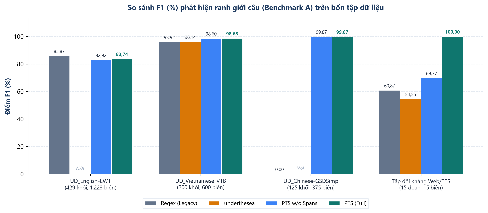
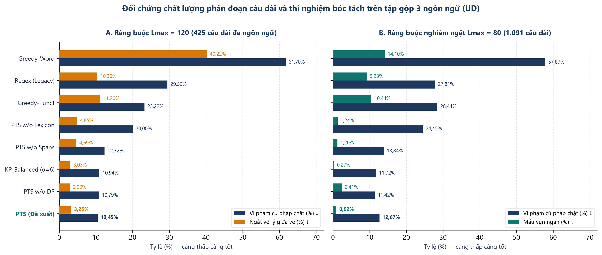
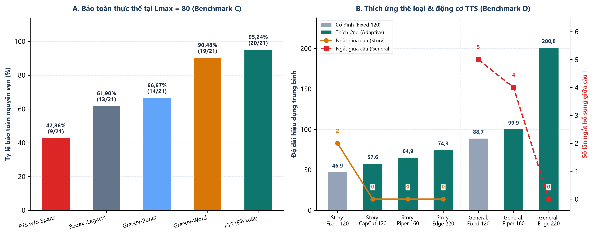

# 5. THỰC NGHIỆM VÀ KẾT QUẢ

Chương này trình bày chi tiết quy trình đánh giá thực nghiệm nhằm kiểm chứng hiệu quả của thuật toán phân đoạn văn bản ưu tiên ngữ điệu (PTS) và tính đúng đắn của hệ thống theo năm nội dung: dữ liệu thực nghiệm, môi trường triển khai, kịch bản thử nghiệm, kết quả thu được và phân tích đánh giá khách quan.

## 5.1. Dữ liệu thực nghiệm

Để bảo đảm tính khách quan và khả năng đối chứng trên nhiều loại hình ngôn ngữ, bộ thực nghiệm sử dụng đồng thời các kho ngữ liệu chuẩn quốc tế Universal Dependencies (UD) và các tập dữ liệu kiểm thử chuyên biệt cho môi trường web – tổng hợp tiếng nói. Bảng 5.1 tổng hợp cấu trúc và quy mô toàn bộ nguồn dữ liệu đã sử dụng.

| Nhóm dữ liệu | Nguồn / Ngôn ngữ | Quy mô đầu vào | Mục đích đánh giá trong thực nghiệm |
| :--- | :--- | :--- | :--- |
| `UD_Vietnamese-VTB` | Tiếng Việt (báo chí) | `800` câu (`200` khối × `4` câu, `600` biên câu); `40` câu dài ($L_{\max}=120$), `297` câu dài ($L_{\max}=80$) | Đánh giá SBD tiếng Việt (đã hoàn nguyên khoảng trắng từ ghép) và chất lượng cú pháp phân đoạn trên cây phụ thuộc vàng. |
| `UD_English-EWT` | Tiếng Anh (web, blog, tin tức) | `2.077` câu (`429` khối đa câu, `1.223` biên câu); `247` câu dài ($L_{\max}=120$), `501` câu dài ($L_{\max}=80$) | Đánh giá SBD trên văn phong web tiếng Anh không đồng nhất và chất lượng phân đoạn dưới ngưỡng $L_{\max}$. |
| `UD_Chinese-GSDSimp` | Tiếng Trung giản thể (bách khoa, tin) | `500` câu (`125` khối × `4` câu, `375` biên câu); `138` câu dài ($L_{\max}=120$), `293` câu dài ($L_{\max}=80$) | Đánh giá khả năng tách câu không khoảng trắng và quy đổi độ dài hiệu dụng $w_{\text{CJK}} = 3{,}0$. |
| Tập gộp ba ngôn ngữ (`ALL_3_LANGS`) | Tổng hợp VTB + EWT + GSDSimp | `425` câu dài tại $L_{\max}=120$; `1.091` câu dài tại $L_{\max}=80$ | Đánh giá tổng quát hiệu năng phân đoạn và thực hiện thí nghiệm bóc tách thành phần (*Ablation Study*). |
| Tập đối kháng Web/TTS | Đa ngôn ngữ (Việt, Anh, Trung) | `15` đoạn văn bản (`15` ranh giới câu thật) | Kiểm tra chống cắt nhầm tại URL, email, số thập phân, chức danh, tên kỹ thuật, thoại viết thường và dấu kết câu CJK. |
| Tập áp lực bảo toàn thực thể | Tiếng Việt – Anh tổng hợp | `7` câu chứa `21` thực thể đặc biệt dưới $L_{\max}=80$ | Đo tỷ lệ giữ nguyên vẹn đường dẫn, email, số tiền lớn, phiên bản phần mềm, ngày tháng và tên riêng. |
| Tập thích ứng thể loại | Truyện chữ & Bách khoa/Tin tức | `4` đoạn hội thoại truyện + `4` đoạn tin tức/bách khoa | Đánh giá tác động của chế độ `story`/`general` cùng ba ngưỡng động cơ CapCut (`120`), Piper (`160`) và Edge (`220`). |
| Tập kiểm thử chéo đa môi trường | Đa dạng biên Unicode, BMP, 3 ngôn ngữ | `321` trường hợp × `4` cấu hình thích ứng (`1.284` lượt) | Kiểm chứng sự trùng khớp tuyệt đối giữa bộ cài đặt TypeScript và bản tham chiếu Python. |

*Bảng 5.1. Tổng hợp quy mô và vai trò của các tập dữ liệu thực nghiệm.*

Với tập `UD_Vietnamese-VTB`, do dữ liệu gốc tách sẵn các âm tiết trong từ ghép bằng dấu gạch dưới hoặc khoảng trắng nhân tạo theo chuẩn cây cú pháp, bộ chuẩn bị dữ liệu tiến hành hoàn nguyên chuỗi về dạng văn bản web tự nhiên rồi ánh xạ lại ranh giới từng token vàng lên chỉ số ký tự thực tế, bảo đảm việc đo lỗi cắt giữa từ ghép và vi phạm quan hệ phụ thuộc phản ánh chính xác dữ liệu vận hành ngoài thực tế.

## 5.2. Môi trường thực nghiệm

Toàn bộ các phép đo định lượng, thí nghiệm đối chứng và kiểm thử đồng bộ được thực thi đồng nhất trên một máy tính cá nhân tiêu chuẩn nhằm kiểm chứng khả năng chạy thời gian thực ngay trên thiết bị người dùng phổ thông mà không cần tăng tốc GPU chuyên dụng. Về phần cứng, thiết bị sử dụng bộ vi xử lý Intel Core i5-1135G7 xung nhịp cơ sở 2,40 GHz (4 nhân vật lý, 8 luồng xử lý) cùng dung lượng bộ nhớ RAM 8 GB (7,7 GB khả dụng hệ thống), chạy hệ điều hành Microsoft Windows 10 (64-bit, bản dựng 19044).

Về phần mềm và môi trường chạy, đường ống phía máy chủ vận hành trên Python 3.11.9 với các gói thư viện chính xác của hệ thống gồm FastAPI 0.141.1, `httpx` 0.28.1, `edge-tts` 7.3.1, `piper-tts` 1.8.0 và `onnxruntime` 1.19.2. Thư viện xử lý ngôn ngữ tự nhiên tiếng Việt `underthesea` phiên bản 9.5.0 được dùng làm hệ quy chiếu cho bài toán phát hiện ranh giới câu tiếng Việt. Phía trình duyệt và kiểm chứng chéo TypeScript thực thi trên Node.js phiên bản v20.18.0 với mã nguồn biên dịch từ TypeScript 5.4.

## 5.3. Kịch bản thử nghiệm

Quá trình đánh giá được thiết kế thành năm kịch bản độc lập nhằm đo đạc riêng từng khía cạnh từ chất lượng tách câu, phân đoạn cú pháp, bảo toàn thực thể, thích ứng động cơ cho tới tính đồng bộ đa môi trường.

**Kịch bản 1 (Phát hiện ranh giới câu – SBD):** Bộ tách câu của PTS được chạy đối chứng với phương pháp biểu thức chính quy cổ điển (`Regex`), thư viện `underthesea` (trên tập tiếng Việt và tập đối kháng đa ngôn ngữ) cùng biến thể không dùng vùng bảo vệ (`PTS w/o Spans`) trên cả bốn tập ngữ liệu SBD. Tập thước đo gồm `Precision`, `Recall`, `F1 (%)`, số ca ngắt nhầm dương tính giả (`FP`) và số biên bị bỏ sót âm tính giả (`FN`).

**Kịch bản 2 (Phân đoạn câu dài và Thí nghiệm bóc tách thành phần):** Toàn bộ các câu có độ dài hiệu dụng vượt ngưỡng $L_{\max}$ trong ba kho UD được đưa qua tám phương pháp tại hai ngưỡng giới hạn: $L_{\max} = 120$ (đại diện cho API ngắn như CapCut/TikTok) và $L_{\max} = 80$ (ngưỡng khắt khe để kiểm tra áp lực). Các hệ thống đối chứng gồm `Regex` truyền thống, hai chiến lược tham lam (`Greedy-Word` ngắt ở từ xa nhất dưới $L_{\max}$, `Greedy-Punct` ưu tiên dấu câu gần $L_{\max}$), mô hình cân bằng độ dài kiểu Knuth–Plass (`KP-Balanced`, $\alpha = 6{,}0$), ba biến thể bóc tách (`PTS w/o DP`, `PTS w/o Spans`, `PTS w/o Lexicon`) và mô hình đề xuất `PTS (Prosody-First)`. Chất lượng phân hoạch được đo bằng mười thước đo: tỷ lệ tuân thủ độ dài $\le L_{\max}$, tỷ lệ bảo toàn toàn vẹn chuỗi (`Lossless`), tỷ lệ vết cắt rơi vào giữa từ ghép, tỷ lệ vi phạm 12 quan hệ phụ thuộc chặt trên cây UD vàng, tỷ lệ cắt trùng dấu câu hoặc 11 ranh giới mệnh đề lớn, tỷ lệ ngắt vô lý giữa cụm từ, số cung phụ thuộc bị cắt trung bình (*cut depth*), hệ số biến thiên độ dài đoạn (`CV`), tỷ lệ mẩu vụn ngắn và thời gian thực thi trung bình trên 1.000 ký tự.

**Kịch bản 3 (Bảo toàn thực thể nhạy cảm):** Năm phương pháp tiêu biểu (`Regex`, `Greedy-Word`, `Greedy-Punct`, `PTS w/o Spans`, `PTS`) được đánh giá dưới giới hạn ngặt $L_{\max} = 80$ trên `21` thực thể phức tạp để đo tỷ lệ giữ nguyên vẹn từng thực thể trong cùng một phân đoạn, đồng thời vẫn yêu cầu giữ $100\%$ chuẩn độ dài và không mất ký tự.

**Kịch bản 4 (Thích ứng đa thể loại và động cơ TTS):** Bộ `Story_Dialogue` và `General_Wiki_News` được chạy thử qua cấu hình cố định `Fixed (120)` so với các cấu hình thích ứng tương ứng theo động cơ CapCut (`120`), Piper (`160`) và Edge Neural (`220`), thống kê tổng số phân đoạn sinh ra, số lần cắt bổ sung giữa câu, độ dài hiệu dụng trung bình và tỷ lệ mảnh ngắn $\le 24$ đơn vị.

**Kịch bản 5 (Đồng nhất đa môi trường và kiểm thử tích hợp):** Chạy đồng loạt `321` mẫu kiểm thử dưới `4` cấu hình thích ứng (`1.284` lượt chạy) song song trên Python và TypeScript (Node.js) để kiểm đếm sai lệch vị trí biên cắt, kết hợp chạy bộ `14` ca kiểm thử đơn vị bao phủ các quy tắc ngôn ngữ và tích hợp phiên làm việc trên máy chủ.

## 5.4. Kết quả thực nghiệm

### 5.4.1. Kết quả phát hiện ranh giới câu (Kịch bản 1)

Bảng 5.2 và Hình 5.1 trình bày kết quả đối chứng chi tiết trên bốn tập dữ liệu tách câu. Trên tập tiếng Việt `UD_Vietnamese-VTB`, `PTS (Full)` đạt F1 **`98,68%`** với `Recall = 100,00%` và chỉ `16` trường hợp ngắt dư (`FP`), giảm gần hai phần ba lượng cắt nhầm so với `underthesea` (`45` FP, F1 `96,14%`) và `Regex` (`51` FP, F1 `95,92%`). Trên tập tiếng Trung `UD_Chinese-GSDSimp`, phương pháp `Regex` dựa trên khoảng trắng sau dấu câu hoàn toàn không tách được câu nào (`F1 = 0,00%`), trong khi PTS đạt `Precision = 100,00%` và `F1 = 99,87%` (`374/375` biên câu). Đặc biệt trên tập đối kháng Web/TTS, chỉ riêng `PTS (Full)` đạt **`100,00%`** trên cả hai chỉ số `Precision` và `Recall` (`FP = 0`, `FN = 0`), vượt xa biến thể không có vùng bảo vệ (`69,77%`), `Regex` (`60,87%`) và `underthesea` (`54,55%`). Trên tập `UD_English-EWT`, `PTS (Full)` đạt `Precision = 99,22%` (`FP = 7`, thấp gấp 7 lần so với `49` của `Regex`) và `F1 = 83,74%`.

| Tập dữ liệu | Phương pháp | Precision (%) | Recall (%) | F1 (%) | FP | FN |
| :--- | :--- | ---: | ---: | ---: | ---: | ---: |
| `UD_English-EWT` (`429` khối, `1.223` biên) | `Regex (Legacy)` | `95,13` | `78,25` | **`85,87`** | `49` | `266` |
| | `PTS w/o Spans` | `96,94` | `72,44` | `82,92` | `28` | `337` |
| | `PTS (Full)` | `99,22` | `72,44` | `83,74` | `7` | `337` |
| `UD_Vietnamese-VTB` (`200` khối, `600` biên) | `Regex (Legacy)` | `92,17` | `100,00` | `95,92` | `51` | `0` |
| | `underthesea 9.5.0` | `92,99` | `99,50` | `96,14` | `45` | `3` |
| | `PTS w/o Spans` | `97,24` | `100,00` | `98,60` | `17` | `0` |
| | `PTS (Full)` | `97,40` | `100,00` | **`98,68`** | `16` | `0` |
| `UD_Chinese-GSDSimp` (`125` khối, `375` biên) | `Regex (Legacy)` | `0,00` | `0,00` | `0,00` | `0` | `375` |
| | `PTS w/o Spans` | `100,00` | `99,73` | **`99,87`** | `0` | `1` |
| | `PTS (Full)` | `100,00` | `99,73` | **`99,87`** | `0` | `1` |
| Tập đối kháng Web/TTS (`15` đoạn, `15` biên) | `Regex (Legacy)` | `45,16` | `93,33` | `60,87` | `17` | `1` |
| | `underthesea 9.5.0` | `41,38` | `80,00` | `54,55` | `17` | `3` |
| | `PTS w/o Spans` | `53,57` | `100,00` | `69,77` | `13` | `0` |
| | `PTS (Full)` | `100,00` | `100,00` | **`100,00`** | `0` | `0` |

*Bảng 5.2. Kết quả đối chứng phát hiện ranh giới câu (Benchmark A) trên bốn tập dữ liệu.*

*Hình 5.1. Biểu đồ đối chứng chỉ số F1 (%) phát hiện ranh giới câu giữa các phương pháp trên bốn tập ngữ liệu.*

### 5.4.2. Kết quả phân đoạn câu dài và thí nghiệm bóc tách (Kịch bản 2)

Bảng 5.3 và Bảng 5.4 lần lượt báo cáo kết quả chi tiết trên tập gộp `ALL_3_LANGS` tại hai ngưỡng ràng buộc độ dài $L_{\max} = 120$ (`425` câu dài) và $L_{\max} = 80$ (`1.091` câu dài), kết hợp kết quả riêng của từng ngôn ngữ ở Bảng 5.5 và trực quan hóa ở Hình 5.2.

Tại giới hạn vận hành tiêu chuẩn $L_{\max} = 120$, toàn bộ bảy phương pháp hiện đại đều đạt `100,0%` tuân thủ độ dài và `100,0%` không thất thoát ký tự (`Lossless`), trong khi `Regex (Legacy)` chỉ đạt `82,4%` tuân thủ độ dài (chủ yếu do thất bại trên tiếng Trung) và vi phạm cú pháp chặt tới `29,50%`. Trong nhóm tham lam, `Greedy-Word` tạo ra `61,70%` vết cắt vi phạm quan hệ cú pháp chặt và `40,22%` ngắt vô lý giữa vế. Mô hình đề xuất `PTS (Prosody-First)` đạt tỷ lệ vi phạm cú pháp chặt thấp nhất toàn bảng là **`10,45%`**, giữ đúng mệnh đề/dấu câu **`95,08%`**, chỉ `0,55%` mẩu vụn và duy trì tốc độ `7,23 ms / 1.000` ký tự.

| Phương pháp ($L_{\max}=120$) | $\le L_{\max}$ (%) | Cắt giữa từ (%) $\downarrow$ | Vi phạm chặt (%) $\downarrow$ | Đúng mệnh đề (%) $\uparrow$ | Ngắt vô lý (%) $\downarrow$ | Cung cắt TB $\downarrow$ | Lệch CV | Mẩu vụn (%) $\downarrow$ | Tốc độ (ms/1k) |
| :--- | ---: | ---: | ---: | ---: | ---: | ---: | ---: | ---: | ---: |
| `Regex (Legacy)` | `82,4` | `6,79` | `29,50` | `84,60` | `10,36` | `2,28` | `0,410` | `5,57` | `1,96` |
| `Greedy-Word` | `100,0` | `14,26` | `61,70` | `57,23` | `40,22` | `2,63` | `0,552` | `13,18` | `2,19` |
| `Greedy-Punct` | `100,0` | `1,69` | `23,22` | `85,21` | `11,20` | `2,23` | `0,397` | `6,47` | `2,46` |
| `KP-Balanced (α=6)` | `100,0` | `2,11` | `10,94` | **`95,20`** | `3,03` | `2,09` | `0,171` | `0,00` | `7,77` |
| `PTS w/o DP` | `100,0` | `2,74` | `10,79` | `94,70` | **`2,90`** | **`1,95`** | `0,270` | `0,93` | `4,25` |
| `PTS w/o Spans` | `100,0` | `3,43` | `12,32` | `93,54` | `4,69` | `2,11` | `0,210` | `0,98` | `7,24` |
| `PTS w/o Lexicon` | `100,0` | `2,40` | `20,00` | `92,80` | `4,85` | `2,25` | `0,188` | `0,65` | `6,72` |
| **`PTS (Prosody-First)`** | **`100,0`** | `2,25` | **`10,45`** | `95,08` | `3,25` | `2,06` | `0,202` | `0,55` | `7,23` |

*Bảng 5.3. Kết quả phân đoạn câu dài và thí nghiệm bóc tách trên `ALL_3_LANGS` (`425` câu) tại $L_{\max}=120$ (toàn bộ các phương pháp ngoài `Regex` đạt `100,0%` Lossless; `Regex` đạt `99,8%`).*

Khi siết chặt ngưỡng xuống $L_{\max} = 80$ trên `1.091` câu dài (Bảng 5.4), `PTS (Prosody-First)` vẫn duy trì `100,0%` tuân thủ độ dài, giữ tỷ lệ đúng mệnh đề/dấu câu **`91,25%`**, cắt giữa từ chỉ `1,99%` và giảm tỷ lệ mẩu vụn từ `2,41%` (khi không có quy hoạch động) xuống còn **`0,92%`** ở tốc độ `6,48 ms / 1.000` ký tự. Đặc biệt, kết quả thí nghiệm bóc tách cho thấy khi loại bỏ từ điển hư từ – tiểu từ (`PTS w/o Lexicon`), tỷ lệ vi phạm cú pháp chặt tăng xấp xỉ gấp đôi ở cả hai ngưỡng (`10,45% -> 20,00%` tại `120` và `12,67% -> 24,45%` tại `80`).

| Phương pháp ($L_{\max}=80$) | $\le L_{\max}$ (%) | Cắt giữa từ (%) $\downarrow$ | Vi phạm chặt (%) $\downarrow$ | Đúng mệnh đề (%) $\uparrow$ | Ngắt vô lý (%) $\downarrow$ | Cung cắt TB $\downarrow$ | Lệch CV | Mẩu vụn (%) $\downarrow$ | Tốc độ (ms/1k) |
| :--- | ---: | ---: | ---: | ---: | ---: | ---: | ---: | ---: | ---: |
| `Regex (Legacy)` | `86,6` | `5,36` | `27,81` | `83,93` | `10,20` | `2,21` | `0,398` | `9,23` | `2,29` |
| `Greedy-Word` | `100,0` | `16,35` | `57,87` | `54,33` | `43,32` | `2,45` | `0,476` | `14,10` | `2,39` |
| `Greedy-Punct` | `100,0` | `4,96` | `28,44` | `81,41` | `14,27` | `2,13` | `0,390` | `10,44` | `2,30` |
| `KP-Balanced (α=6)` | `100,0` | **`1,78`** | `11,72` | **`91,71`** | `5,42` | `2,01` | `0,196` | **`0,27`** | `12,07` |
| `PTS w/o DP` | `100,0` | `2,06` | **`11,42`** | `91,52` | **`5,10`** | **`1,90`** | `0,265` | `2,41` | `4,69` |
| `PTS w/o Spans` | `100,0` | `2,75` | `13,84` | `90,32` | `6,47` | `2,01` | `0,208` | `1,20` | `6,21` |
| `PTS w/o Lexicon` | `100,0` | `3,52` | `24,45` | `88,37` | `8,83` | `2,24` | `0,170` | `1,24` | `6,09` |
| **`PTS (Prosody-First)`** | **`100,0`** | `1,99` | `12,67` | `91,25` | `5,59` | `2,00` | `0,206` | `0,92` | `6,48` |

*Bảng 5.4. Kết quả phân đoạn câu dài và thí nghiệm bóc tách trên `ALL_3_LANGS` (`1.091` câu) tại $L_{\max}=80$ (toàn bộ các phương pháp ngoài `Regex` đạt `100,0%` Lossless; `Regex` đạt `99,1%`).*

Bảng 5.5 bổ sung số liệu chi tiết theo từng ngôn ngữ tại mức $L_{\max} = 120$. Trên ngữ liệu tiếng Việt `vi_vtb` (`40` câu dài), PTS đạt **`0,00%` cắt giữa từ**, **`100,00%` khớp ranh giới mệnh đề/dấu câu** và **`0,00%` ngắt vô lý giữa vế** (trong khi `KP-Balanced` ghi nhận `2,78%` ngắt vô lý và `Regex` vi phạm cú pháp chặt tới `30,00%`). Trên tiếng Trung `zh_gsdsimp` (`138` câu dài), PTS đạt `98,73%` khớp ranh giới mệnh đề với chỉ `5,73%` vi phạm chặt (thấp nhất trong các phương pháp ngoại trừ `Regex` không tách được văn bản CJK khiến `0,0%` câu đạt $\le L_{\max}$). Trên tiếng Anh `en_ewt` (`247` câu dài), PTS đạt `13,75%` vi phạm chặt, cải thiện rõ rệt so với `28,81%` khi bỏ từ điển hư từ, `29,62%` của `Regex` và `58,72%` của `Greedy-Word`.

| Ngôn ngữ (Số câu dài tại $L_{\max}=120$) | Phương pháp | $\le L_{\max}$ (%) | Cắt giữa từ (%) $\downarrow$ | Vi phạm chặt (%) $\downarrow$ | Đúng mệnh đề (%) $\uparrow$ | Ngắt vô lý (%) $\downarrow$ |
| :--- | :--- | ---: | ---: | ---: | ---: | ---: |
| `vi_vtb` (`40` câu) | `Regex (Legacy)` | `100,0` | `0,00` | `30,00` | `92,50` | `2,78` |
| | `Greedy-Word` | `100,0` | `30,00` | `57,50` | `22,50` | `75,00` |
| | `KP-Balanced (α=6)` | `100,0` | `0,00` | **`2,50`** | `97,50` | `2,78` |
| | `PTS (Prosody-First)` | `100,0` | **`0,00`** | `5,00` | **`100,00`** | **`0,00`** |
| `en_ewt` (`247` câu) | `Regex (Legacy)` | `99,7` | `7,62` | `29,62` | `83,58` | `11,29` |
| | `Greedy-Word` | `100,0` | **`2,14`** | `58,72` | `63,35` | `32,69` |
| | `KP-Balanced (α=6)` | `100,0` | `3,22` | `14,15` | **`92,60`** | **`4,50`** |
| | `PTS w/o Lexicon` | `100,0` | `3,31` | `28,81` | `88,74` | `7,86` |
| | `PTS (Prosody-First)` | `100,0` | `3,09` | **`13,75`** | `92,44` | `4,83` |
| `zh_gsdsimp` (`138` câu) | `Regex (Legacy)` | `0,0` | `0,00` | `0,00` | `100,00` | `0,00` |
| | `Greedy-Word` | `100,0` | `32,89` | `68,46` | `55,03` | `44,97` |
| | `KP-Balanced (α=6)` | `100,0` | **`0,59`** | `7,06` | **`99,41`** | **`0,59`** |
| | `PTS (Prosody-First)` | `100,0` | `1,27` | **`5,73`** | `98,73` | `1,27` |

*Bảng 5.5. Kết quả phân đoạn câu dài chi tiết theo từng ngôn ngữ tại giới hạn $L_{\max}=120$.*

*Hình 5.2. So sánh tỷ lệ vi phạm cú pháp chặt, ngắt vô lý giữa vế và mẩu vụn ngắn giữa các phương pháp tại $L_{\max}=120$ và $L_{\max}=80$.*

### 5.4.3. Kết quả bảo toàn thực thể và thích ứng động cơ (Kịch bản 3 & 4)

Bảng 5.6 ghi nhận kết quả bảo toàn thực thể ở ngưỡng ngặt $L_{\max} = 80$. Khi bỏ lớp vùng bảo vệ (`PTS w/o Spans`), tỷ lệ giữ nguyên thực thể chỉ còn **`42,86%` (`9/21`)**, tụt xuống dưới cả `Regex` (`61,90%`) do bộ tách có xu hướng cắt tại dấu chấm nội bộ của số liệu, tên miền hay chức danh. Khi kích hoạt đầy đủ Tầng 2, `PTS (Prosody-First)` đạt tỷ lệ bảo toàn cao nhất là **`95,24%` (`20/21`)**, đồng thời bảo đảm `100,0%` không vượt $L_{\max}$ và `100,0%` Lossless (trong khi `Regex` để `14,3%` mẫu vượt giới hạn độ dài).

| Phương pháp ($L_{\max}=80$) | Bảo toàn thực thể (%) $\uparrow$ | Bảo toàn / Tổng số | Lossless (%) | Tuân thủ $\le L_{\max}$ (%) |
| :--- | ---: | :---: | ---: | ---: |
| `Regex (Legacy)` | `61,90` | `13/21` | `100,0` | `85,7` |
| `Greedy-Word` | `90,48` | `19/21` | `100,0` | `100,0` |
| `Greedy-Punct` | `66,67` | `14/21` | `100,0` | `100,0` |
| `PTS w/o Spans` | `42,86` | `9/21` | `100,0` | `100,0` |
| **`PTS (Prosody-First)`** | **`95,24`** | **`20/21`** | **`100,0`** | **`100,0`** |

*Bảng 5.6. Kết quả đánh giá khả năng bảo toàn nguyên vẹn 21 thực thể nhạy cảm tại $L_{\max}=80$.*

Đối với cơ chế thích ứng đa thể loại và động cơ (Bảng 5.7 và Hình 5.3), trên tập hội thoại truyện chữ `Story_Dialogue`, chuyển từ chế độ `Fixed General (120)` sang `Adaptive Story + CapCut (120)` giúp giảm tổng số phân đoạn từ `11` xuống `9`, đưa số lần cắt bổ sung giữa câu từ `2` về **`0`** và giảm hơn một nửa tỷ lệ mảnh vụn $\le 24$ ký tự (từ `45,45%` xuống `22,22%`). Khi mở rộng ngưỡng cho Piper (`160`) và Edge (`220`), độ dài trung bình mỗi lượt phát tăng dần lên `64,9` và `74,3` trong khi vẫn giữ nguyên `0` lần ngắt giữa câu. Trên tập tin tức/bách khoa `General_Wiki_News`, việc thích ứng sang `Edge (220)` loại bỏ hoàn toàn cả `5` vết ngắt bổ sung giữa câu (`5 -> 0`), giảm tổng số đoạn từ `9` xuống `4` và nâng độ dài trung bình lên `200,8`.

| Nhóm nội dung | Chế độ cấu hình | Tổng chunks | Ngắt bổ sung giữa câu $\downarrow$ | Độ dài hiệu dụng TB | Mảnh $\le 24$ (%) $\downarrow$ |
| :--- | :--- | ---: | ---: | ---: | ---: |
| `Story_Dialogue` (`4` đoạn truyện) | `Fixed General (120)` | `11` | `2` | `46,9` | `45,45` |
| | `Adaptive Story + CapCut (120)` | `9` | `0` | `57,6` | `22,22` |
| | `Adaptive Story + Piper (160)` | `8` | `0` | `64,9` | `25,00` |
| | `Adaptive Story + Edge (220)` | `7` | `0` | `74,3` | `28,57` |
| `General_Wiki_News` (`4` đoạn bách khoa) | `Fixed (120)` | `9` | `5` | `88,7` | `0,00` |
| | `Adaptive General + Piper (160)` | `8` | `4` | `99,9` | `0,00` |
| | `Adaptive General + Edge (220)` | `4` | `0` | `200,8` | `0,00` |

*Bảng 5.7. Kết quả thực nghiệm cơ chế thích ứng thể loại và động cơ TTS (Benchmark D).*

*Hình 5.3. Kết quả Benchmark C (trái) và Benchmark D (phải) thể hiện hiệu quả của vùng bảo vệ và chế độ thích ứng.*

### 5.4.4. Kết quả đồng bộ hai môi trường và kiểm thử tích hợp (Kịch bản 5)

Trong phép kiểm tra đối chứng chéo trên `321` trường hợp biên qua `4` cấu hình thích ứng (`1.284` lượt chạy độc lập), kết quả đầu ra giữa bộ phân đoạn TypeScript (chạy trên Node.js v20.18.0) và bản tham chiếu Python đạt **`0` sai lệch (`100,00%` đồng nhất)** về ranh giới từng phân đoạn. Tổng thời gian thực thi cho toàn bộ `1.284` lượt chạy đạt `603,69 ms` phía Python và `167,04 ms` phía TypeScript/Node.js (trung bình dưới `0,5 ms` mỗi mẫu). Đồng thời, toàn bộ `14/14` ca kiểm thử đơn vị tự động — bao gồm kiểm thử tích hợp nối máy chủ tổng hợp đa động cơ và kiểm tra các quy tắc ngôn ngữ học Việt, Anh, Trung — đều vượt qua sau `0,775` giây.

## 5.5. Đánh giá

Từ toàn bộ dữ liệu thực nghiệm thu được, có thể rút ra bốn nhận định khách quan về ưu điểm cũng như giới hạn còn tồn tại của giải pháp đề xuất.

Thứ nhất, ở bài toán phát hiện ranh giới câu đa ngôn ngữ, việc kết hợp phân loại ký tự Unicode với bộ luật ngoại lệ ngữ cảnh và vùng bảo vệ cứng giúp nâng cao rõ rệt độ chính xác thực tế so với quy tắc `Regex` lẫn bộ tách câu chuyên biệt `underthesea` trên văn bản web hỗn hợp (`100,00%` F1 trên tập đối kháng, `98,68%` trên tiếng Việt và `99,87%` trên tiếng Trung). Một điểm cần phân tích thẳng thắn là trên `UD_English-EWT`, chỉ số `F1` của PTS (`83,74%`) thấp hơn nhẹ so với `Regex` (`85,87%`). Kiểm tra chi tiết các ca bỏ sót (`FN = 337`) cho thấy tập ngữ liệu diễn đàn và email tiếng Anh này gán nhiều biên câu tại vị trí dấu hai chấm (`:`), dấu chấm phẩy (`;`), dòng tiêu đề bản tin hoặc câu kết thúc thiếu dấu chấm cuối câu; trong khi PTS chủ động giữ dấu hai chấm và chấm phẩy làm ranh giới mệnh đề nội câu (`0,5` trong quy hoạch động) nhằm tránh cắt rời lời dẫn khỏi giải thích theo sau, đổi lại giảm được số ca cắt nhầm dương tính giả xuống còn `7` (so với `49` của `Regex`, đạt `Precision = 99,22%`). Trên `UD_Chinese-GSDSimp`, ca bỏ sót duy nhất (`1/375`) cũng rơi vào đúng một câu thiếu dấu câu kết thúc trong dữ liệu gốc.

Thứ hai, thí nghiệm bóc tách trên tập gộp `1.091` câu tại `80` và `425` câu tại `120` khẳng định sự đóng góp thiết yếu của từng tầng trong kiến trúc bốn tầng của PTS. Việc bỏ đi danh sách từ chức năng bám phải và tiểu từ hậu trí làm tỷ lệ vi phạm cú pháp chặt tăng gần gấp đôi (`10,45% -> 20,00%` tại `120` và `12,67% -> 24,45%` tại `80`), cho thấy mở rộng quy luật *Chinks 'n Chunks* sang tiếng Việt và tiếng Trung có hiệu quả trực tiếp. Tương tự, bỏ vùng bảo vệ làm tỷ lệ giữ thực thể giảm từ `95,24%` xuống `42,86%`, còn bỏ quy hoạch động làm tăng mạnh tỷ lệ mẩu vụn ngắn và độ biến thiên độ dài đoạn (`CV`). So với `KP-Balanced (α = 6)`, dù mô hình cân bằng độ dài cho độ đồng đều `CV` nhỏ hơn đôi chút (`0,171` so với `0,202`), PTS đạt tỷ lệ vi phạm cú pháp chặt tốt hơn trên tập gộp tại $L_{\max}=120$ (`10,45%` so với `10,94%`), đặc biệt loại bỏ hoàn toàn hiện tượng ngắt vô lý trên ngữ liệu tiếng Việt (`0,00%` so với `2,78%`), phù hợp hơn với đặc thù tiếp thu thính giác của TTS.

Thứ ba, về tính khả thi triển khai trên tiện ích trình duyệt, tốc độ xử lý của PTS (`7,23 ms / 1.000` ký tự trên Python và nhanh gấp khoảng 3,6 lần trên động cơ V8/Node.js của TypeScript) cùng sự đồng bộ `0` sai lệch trên `1.284` phép thử chéo cho thấy thuật toán đủ nhẹ để chạy trực tiếp ngay trong tiến trình trình duyệt khi người dùng mở trang web, không cần gửi toàn bộ văn bản thô lên máy chủ mới tách câu được. Cùng với chế độ thích ứng thể loại và động cơ, số vết cắt chắp vá ở khâu phát âm thanh giảm đáng kể trên văn bản truyện lẫn bài viết thông tin dài.

Cuối cùng, thực nghiệm cũng chỉ ra hai giới hạn cụ thể làm cơ sở hoàn thiện tiếp. Ở Benchmark C ($L_{\max} = 80$), trong `21` thực thể kiểm thử có `1` trường hợp bị tách (`Node.` \| `js`, chiếm tỷ lệ lỗi `4,76%`) do thuật toán mới bảo vệ dạng tên công nghệ viết liền dấu chấm ở bước tách câu thông qua ngữ cảnh khoảng trắng chứ chưa bổ sung danh mục định danh phần mềm chứa dấu chấm vào lớp bảo vệ cứng của quy hoạch động. Ngoài ra, bộ thí nghiệm hiện tập trung đo định lượng tự động trên ba bộ cây cú pháp vàng và kiểm thử tích hợp luồng dịch – tổng hợp trên hệ thống; chất lượng tự nhiên của giọng đọc song ngữ sau dịch thuật chưa được đánh giá qua khảo sát điểm nghe chủ quan (MOS – *Mean Opinion Score*) trên nhóm người nghe độc lập, đây sẽ là hạng mục mở rộng có giá trị trong bước nghiên cứu tiếp theo.
